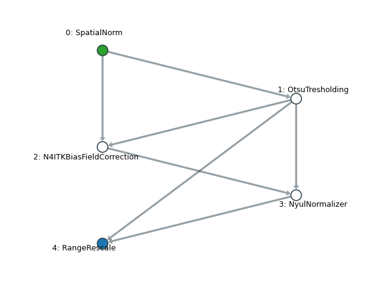
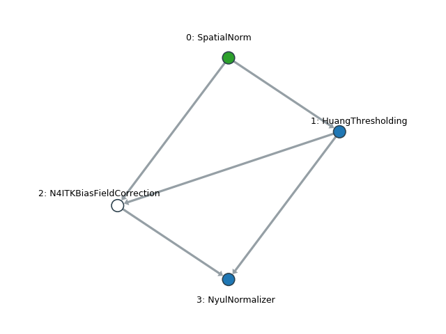

# MRI Normalization Tools

[](https://www.python.org/downloads/)
[](https://badge.fury.io/py/mri-normalization-tools)
[](https://opensource.org/licenses/MIT)
[](https://github.com/alabamagan/mri_normalization_tools/issues)
[](https://github.com/alabamagan/mri_normalization_tools/stargazers)

## Introduction

Quantitative analysis of MRI is complicated, often with a specific set of steps that are complicated and cannot be 
easily reproduced. This project aims to allow one-click reproducibility based on a config file. 

## Features

- **Bias Field Correction**: N4ITK bias field correction for improved image quality
- **Spatial Normalization**: Resampling and orientation correction
- **Intensity Normalization**: Multiple algorithms including Nyul, Z-score, and histogram matching
- **Graph-based Pipeline**: Flexible filter chaining with automatic dependency management
- **Training Support**: Built-in training workflows for normalization algorithms requiring training
- **MPI Support**: Parallel processing capabilities for large datasets
- **YAML Configuration**: Define normalization pipelines using YAML files
- **Console Interface**: Command-line tools for training and inference workflows

## Key Functions

This repo aims to maximize the repeatability of the image normalization pipeline, with a focus of MRI. Normalization
generally consist of the following steps:

1. Bias field correction
2. Align image spacing
3. Outlier removal
4. Intensity normalization
5. Binning

# Requirements

- SimpleITK >= 2.1.0
- networkx >= 2.5
- decorator >= 5.0.7
- cachetools >=4.2.2
- netgraph >= 0.7.0

# Installation

## PyPI Installation

```bash
pip install mri-normalization-tools

# OR, if you need to run scripts like dcm2nii
pip install mri-normalization-tools[pydicom]
```

## Development branch Installation

```bash
git clone https://github.com/alabamagan/mri_normalization_tools.git
cd mri_normalization_tools
pip install -e .

# perform unittest
pip install pytest
cd mri_normalization_tools/
pytest unit_test/
```

## Quick Start

```python
from mnts.filters.geom import SpatialNorm
from mnts.filters.intensity import N4ITKBiasFieldCorrection, NyulNormalizer
from mnts.filters.mnts_filters_graph import MNTSFilterGraph

# Create normalization graph
G = MNTSFilterGraph()
G.add_node(SpatialNorm(out_spacing=[1, 1, 0]))
G.add_node(N4ITKBiasFieldCorrection(), [0])
G.add_node(NyulNormalizer(), [1], is_exit=True)

# Process an image
result = G.execute("path/to/your/image.nii.gz")
```

# Examples

## General Example


 Caption: Green node is the input node, blue node is the output node.

```python
from pathlib import Path
from mnts.filters.geom import *
from mnts.filters.intensity import *
from mnts.filters.mnts_filters_graph import MNTSFilterGraph
import matplotlib.pyplot as plt
import SimpleITK as sitk

from mnts.utils import repeat_zip
from mnts.filters import mpi_wrapper
from mnts.filters.intensity import NyulNormalizer

import pprint

# If this protector is absent, windows python might go into recursive import loop.
if __name__ == '__main__':
    # Create the normalization graph.
    G = MNTSFilterGraph()

    # Add filter nodes to the graph.
    G.add_node(SpatialNorm(out_spacing=[1, 1, 0]))
    G.add_node(OtsuThresholding(), 0)  # Use mask to better match teh histograms
    G.add_node(N4ITKBiasFieldCorrection(), [0, 1])
    G.add_node(NyulNormalizer(), [2, 1])
    G.add_node(RangeRescale(0, 5000), 3, is_exit=True)
    G.add_node(SignalIntensityRebinning(num_of_bins=256), 3, is_exist=True)

    # Plot the graph
    G.plot_graph()
    plt.show()

    # Borrow the trained features, please run example 04 if this reports error.
    state_path = Path(r'./example_data/output/.EG_04_temp/EG_04_States/2_NyulNormalizer.npz')
    G.load_node_states(3, state_path)  # 3 for NyulNormalizer node index

    # Write output images
    image_folder = Path(r'./example_data')
    images = [f for f in image_folder.iterdir() if f.name.find('nii') != -1]
    output_save_dir = Path(r'./example_data/output/EG_05')
    output_save_dir.mkdir(parents=True, exist_ok=True)
    for im in images:
        save_im = G.execute(im)
        fname = output_save_dir.joinpath(im.name).resolve().__str__()
        print(f"Saving to {fname}")
        sitk.WriteImage(save_im[4], fname)  # RangeRescale output at node index 3
```

## Using normalization graph API

Some normalization method require training. For example, most piecewise linear intensity normalization algorithm requries establishing feature points on a graph prior to usage. This package offers API for training these nodes. 

### Identifying nodes that require training

For nodes that requires training, it would be a child class of `MNTSFilterRequireTraining`. You can identify this by using `isinstance(node, MNTSFilterRequireTraining)`. 

### Training example

You can see [example 4](./examples/EG04_using_filters_that_require_train.py) for a more detailed implementation of how to build and train a normalization graph that requires training.

```python
from mnts.filters.mnts_filters_graph import MNTSFilterGraph
from mnts.utils import repeat_zip

G = MNTSFilterGraph("/path/to/graph")

# * Prepare the upstream data for nodes that require training
image_folder = Path("...")
temp_output_folder = Path("...")
images = [f for f in image_folder.iterdir() if f.name.find('nii') != -1]
out_names = [f.name for f in images]

# this prepares the data from nodes that does not require training and are upstream of node X
z = ([X], out_names, [temp_output_folder], images)
for args in repeat_zip(*z):
    G.prepare_training_files(*args)

# Train node number X
G.train_node(X, temp_output_folder, temp_output_folder.joinpath("trained_states"))
```

### Inference Example

```python
from mnts.filters.mnts_filters_graph import MNTSFilterGraph
from mnts.utils import repeat_zip

G = MNTSFilterGraph("/path/to/graph")
output_save_dir = Path(r'./example_data/output/EG_04')
output_save_dir.mkdir(parents=True, exist_ok=True)

G.load_node_states(2, temp_output_folder.joinpath("trained_states"))
for im in images:
    save_im = G.execute(im)
    fname = output_save_dir.joinpath(im.name).resolve().__str__()
    print(f"Saving to {fname}")
    sitk.WriteImage(save_im[3], fname)

```

## Creating graph from yaml file

### Example YAML file



```yaml
SpatialNorm: # This layer should have the same name as the filter name
    out_spacing: [0.5, 0.5, 0] # All kwargs arguments can be specified in this format

HuangThresholding:
    closing_kernel_size: 10
    _ext: # The argument of the method MNTSFilterGraph.add_node(), must be specified with _ext key
        upstream: 0 # Keyword upstream is also necessary, otherwise, the node will be see as an input node.
        is_exit: True

N4ITKBiasFieldCorrection:
    _ext:
        upstream: [0, 1]
  
NyulNormalizer:
    _ext:
        upstream: [2, 1]
        is_exit: True
```

### Python script

```python
from pathlib import Path
from mnts.filters.mnts_filters_graph import MNTSFilterGraph

yaml_file = '_test_graph.yaml'

if __name__ == '__main__':
    G = MNTSFilterGraph.CreateGraphFromYAML('_test_graph.yaml')
    print(G)
    Path('default.log').unlink() # Remove useless log file
```

### Utility scripts

#### `mnts-dicom2nii` — DICOM → NIfTI conversion

```bash
mnts-dicom2nii -i /data/raw -o /data/nifti --use-top-level-fname
mnts-dicom2nii -i /data/raw -o /data/nifti -g '[A-Z]{2}[0-9]{4}'          # ID from path regex
mnts-dicom2nii -i /data/raw -o /data/nifti --idlist "PT001, PT002"         # subset of subjects
mnts-dicom2nii -i /data/raw -o /data/nifti --check-image-type-tag          # DIXON scans
mnts-dicom2nii -i /data/raw -o /data/nifti --add-scan-time                 # multiple sessions
```

#### `mnts-dcm-tagprint` — print DICOM tags to table / CSV / Excel / SQLite

```bash
mnts-dcm-tagprint /data/raw -t 0008|103e                                   # series description
mnts-dcm-tagprint /data/raw -t default                                     # common tag preset
mnts-dcm-tagprint /data/raw -t mri                                         # full MRI parameters
mnts-dcm-tagprint /data/raw -t default -f csv -o tags.csv
mnts-dcm-tagprint /data/raw -t default -f sqlite -o study.db -c Cohort_A
```

Common tags: `0008|103e` Series Description · `0010|0020` Patient ID · `0008|0020` Study Date ·
`0018|0080` TR · `0018|0081` TE · `0018|0087` Field Strength

#### `mnts-organize` — sort NIfTI files into per-modality subdirectories

Expects filenames like `PT001-T1+001_tra.nii.gz` (`PatientID-Modality+SeqID`).

```bash
mnts-organize /data/nifti                                                  # in-place
mnts-organize /data/nifti --target-dir /data/organized
mnts-organize /data/nifti --dry-run                                        # preview only
```

# TODO

- [X] Training required filters
- [X] Intensity normalization ignores segmentation (UInt8 image won't be processed, might need `force` option?)
- [ ] Image registration
- [X] Graph label the filter names
- [X] Overflow protection for some function
- [X] MRI bias field correction
- [ ] Support processing labels together with images (for spatial operations only)
- [X] Finish pipeline implementation
- [X] MPI examples
- [X] Better documents for usage of dicom2nii
- [ ] Better document for scripts
- [ ] Incorporate Bash-based steps
- [ ] Add version and version check for saving graphs

# Example Data

The example data was obtained through the openneuro initiative, accessed [here](https://openneuro.org/datasets/ds000105/versions/00001) [1-3]. The data was not matched with any diagnosis or pathology here. A subset of T1-weighted images were extracted from the original public domain data, which were renamed into the followings:

```
.
└── examples/
    └── example_data/
        ├── MRI_01.nii.gz
        ├── MRI_02.nii.gz
        └── MRI_03.nii.gz
```

## Reference

[1] Haxby, J.V., Gobbini, M.I., Furey, M.L., Ishai, A., Schouten, J.L.,Pietrini, P. (2001). Distributed and overlapping representations of faces and objects in ventral temporal cortex. Science, 293(5539):2425-30

[2] Hanson, S.J., Matsuka, T., Haxby, J.V. (2004). Combinatorial codes in ventral temporal lobe for object recognition:  Haxby (2001) revisited: is there a "face" area? Neuroimage. 23(1):156-66 O'Toole, A.J., Jiang, F.,

[3] Abdi, H., Haxby, J.V. (2005). Partially distributed representations of objects and faces in ventral temporal cortex. J Cogn Neurosci, 17(4):580-90

## License of usage

### This repo

MIT License

### Unit test data

This dataset is made available under the Public Domain Dedication and License v1.0, whose full text can be found at 
[http://www.opendatacommons.org/licenses/pddl/1.0/](http://www.opendatacommons.org/licenses/pddl/1.0/). We hope that all users will follow the ODC 
Attribution/Share-Alike Community Norms ([http://www.opendatacommons.org/norms/odc-by-sa/](http://www.opendatacommons.org/norms/odc-by-sa/)); in particular, while 
not legally required, we hope that all users of the data will acknowledge the OpenfMRI project and NSF Grant OCI-1131441
(R. Poldrack, PI) in any publications.

To acquire the dataset, run `cd uni_test; python download_sample_data.py`. This will download both the dataset for 
unittest and the dataset for examples from openneuro.

#### NIfTI sample

The NIfTI sample file (`unit_test/sample_data/nifti/example4d.nii.gz`) is taken from the [nibabel](https://github.com/nipy/nibabel) test suite and is distributed under the MIT License.

#### DICOM sample

The DICOM sample series (`unit_test/sample_data/sample1/`) is derived from `MR2_J2KI.dcm`, part of the [pydicom-data](https://github.com/pydicom/pydicom-data) repository and distributed under the MIT License.

Run `python unit_test/download_sample_data.py` to download all sample data before executing the unit tests.
